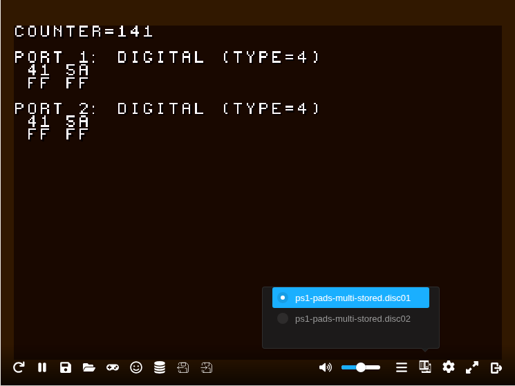
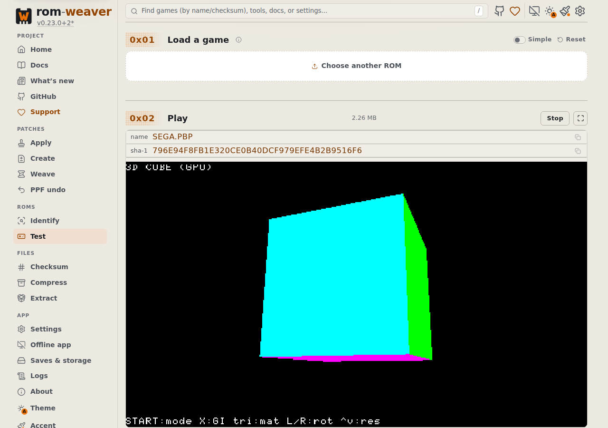
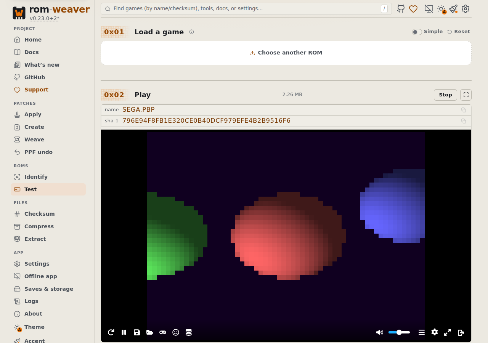

# PBP emulator verification

PBP extraction, loader routing, and successful emulation are separate claims. Synthetic sector fixtures cover extraction and routing; they do not establish that a PS1 or PSP program boots. A core's start callback also does not establish that the supplied program rendered: RetroArch can display its own menu after a content failure.

<!-- START doctoc -->
## Table of contents

- [Legal inputs](#legal-inputs)
- [Reproduce the five cases](#reproduce-the-five-cases)
- [Evidence requirements](#evidence-requirements)
- [Recorded browser run](#recorded-browser-run)
  - [Stored-block fallback and audio retention](#stored-block-fallback-and-audio-retention)
- [Representative PSP captures](#representative-psp-captures)

<!-- END doctoc -->

## Legal inputs

The following upstream inputs require no commercial game, Sony BIOS, or proprietary firmware. Keep downloaded binaries and SDK files in ignored task scratch rather than committing them.

| Input | Source revision | License | SHA-256 |
| --- | --- | --- | --- |
| Cornell-Box PSP `v1.0-C` release `EBOOT.PBP`, 161,444 bytes | [Saymond/PSP-apps, `55553eb`](https://github.com/Saymond/PSP-apps/tree/55553eb52f4c0e1a87de65368df7d299ad2762e1) | [MIT](https://github.com/Saymond/PSP-apps/blob/55553eb52f4c0e1a87de65368df7d299ad2762e1/LICENSE) | `8b4f679ed2494a7b23df5e96e60e2f66eaf1c943a2991089e3c5989d4585f96b` |
| `PSn00bSDK-0.24-Linux.zip` | [PSn00bSDK `v0.24`, `06e65be`](https://github.com/Lameguy64/PSn00bSDK/tree/06e65bea3a778b2dae5af77a7935ae3868ddd4d3) | [Component licenses](https://github.com/Lameguy64/PSn00bSDK/blob/06e65bea3a778b2dae5af77a7935ae3868ddd4d3/LICENSE.md): examples MPL-2.0, SDK MPL-2.0, GCC GPL-3.0, mkpsxiso GPL-2.0-or-later | `5ada7c9478d795b22bde96ee23d6869290c14a740bcde3d57c01c342a26ded35` |

The PSP release is available from its [upstream release](https://github.com/Saymond/PSP-apps/releases/tag/v1.0-C). Its DATA.PSAR offset is 161,444, equal to the file length; DATA.PSP begins at 360. The empty PSAR is intentional. A successful test must render the demo's colored cube rather than only report that PPSSPP started.

## Reproduce the five cases

Use Linux x86-64 from the repository root in a prepared worktree. Complete the [development prerequisites and setup](development.md#prerequisites), including WASI SDK v33 or newer, `mise install`, and both npm installs. The commands below also require `curl`, `unzip`, CMake 3.21 or newer, `sha256sum`, and `openssl`; install the Chromium browser with `node packages/rom-weaver-webapp/node_modules/playwright/cli.js install chromium` before running the check.

Run the following blocks in the same POSIX shell. They create a unique ignored scratch directory, download the two named releases, and verify their hashes before executing any SDK program. Downloaded binaries, toolchains, generated discs, and reports remain in that directory.

```sh
set -eu
mkdir -p "$PWD/.cache/agents/scratch"
PBP_ROOT=$(mktemp -d "$PWD/.cache/agents/scratch/pbp-reproduction.XXXXXX")
export PBP_ROOT
mkdir -p "$PBP_ROOT/fixtures" "$PBP_ROOT/sdk"
curl -fL --retry 3 https://github.com/Lameguy64/PSn00bSDK/releases/download/v0.24/PSn00bSDK-0.24-Linux.zip -o "$PBP_ROOT/sdk.zip"
curl -fL --retry 3 https://github.com/Saymond/PSP-apps/releases/download/v1.0-C/EBOOT.PBP -o "$PBP_ROOT/fixtures/psp-v1.0-C.pbp"
printf '%s  %s\n' 5ada7c9478d795b22bde96ee23d6869290c14a740bcde3d57c01c342a26ded35 "$PBP_ROOT/sdk.zip" 8b4f679ed2494a7b23df5e96e60e2f66eaf1c943a2991089e3c5989d4585f96b "$PBP_ROOT/fixtures/psp-v1.0-C.pbp" | sha256sum -c -
unzip -q "$PBP_ROOT/sdk.zip" -d "$PBP_ROOT/sdk"
PBP_SDK="$PBP_ROOT/sdk/PSn00bSDK-0.24-Linux"
cmake -S "$PBP_SDK/share/psn00bsdk/examples/io/pads" -B "$PBP_ROOT/pads-build" -DCMAKE_TOOLCHAIN_FILE="$PBP_SDK/lib/libpsn00b/cmake/sdk.cmake" -DPSN00BSDK_TC="$PBP_SDK/bin"
cmake --build "$PBP_ROOT/pads-build"
printf '%s\n' 'BOOT = cdrom:\PADS.EXE;1' 'TCB = 4' 'EVENT = 10' 'STACK = 801FFFF0' > "$PBP_ROOT/system.cnf"
cat > "$PBP_ROOT/iso.xml" <<XML
<iso_project image_name="$PBP_ROOT/fixtures/pads.bin" cue_sheet="$PBP_ROOT/pads.cue"><track type="data"><identifiers system="PLAYSTATION" application="PLAYSTATION" volume="LEGAL_PADS"/><directory_tree><file name="SYSTEM.CNF" type="data" source="$PBP_ROOT/system.cnf"/><file name="PADS.EXE" type="data" source="$PBP_ROOT/pads-build/pads.exe"/><dummy sectors="1024"/></directory_tree></track></iso_project>
XML
"$PBP_SDK/bin/mkpsxiso" "$PBP_ROOT/iso.xml" -y
```

The `io/pads` program displays controller bytes and a counter. The image configuration deliberately supplies no proprietary Sony license sector. Wrap its actual raw Mode 2 sectors with the tracked builder; duplicating the demo proves disk selection and continued execution, rather than a game's cross-disc save progression. The stored cases append 75 sectors of locally generated stereo 44.1 kHz signed 16-bit little-endian 440 Hz PCM, then declare an AUDIO track after the 1,060 data sectors.

```sh
node --input-type=module <<'JS'
import { readFile, writeFile } from "node:fs/promises";
import { packHomebrewPbp } from "./packages/rom-weaver-webapp/tests/fixtures/psn00bsdk-pbp.mjs";
const root = `${process.env.PBP_ROOT}/fixtures/`;
const data = await readFile(root + "pads.bin");
const audio = Buffer.alloc(75 * 2352);
for (let frame = 0; frame < audio.length / 4; frame += 1) {
  const sample = Math.round(Math.sin(frame * 2 * Math.PI * 440 / 44100) * 8192);
  audio.writeInt16LE(sample, frame * 4);
  audio.writeInt16LE(sample, frame * 4 + 2);
}
const full = Buffer.concat([data, audio]);
await writeFile(root + "pads-audio.bin", full);
for (const stored of [false, true]) for (const count of [1, 2]) {
  const image = stored ? full : data;
  const bytes = packHomebrewPbp(Array(count).fill(image), {
    stored, audioStartSector: stored ? data.length / 2352 : undefined,
  });
  await writeFile(root + `ps1-pads-${count === 1 ? "single" : "multi"}${stored ? "-stored" : ""}.pbp`, bytes);
}
JS
```

Build production WASM and the webapp before starting the preview. These builds can take several minutes. The direct preview-server command below serves that bundle without invoking `ensure-preview-build.mjs`, which can rebuild a development WASM artifact. Restart the preview after any subsequent build: it caches the manifest and HTML for its lifetime.

```sh
CARGO_BUILD_JOBS=2 mise run build-wasm-prod
npm --prefix packages/rom-weaver-webapp run build
npm --prefix packages/rom-weaver-webapp run check:size
sha256sum packages/rom-weaver-webapp/vendor/emulatorjs.lock.json > "$PBP_ROOT/emulatorjs-lock-sha256.txt"
PBP_REVISION=$(git rev-parse HEAD)
PBP_WASM_SHA256=$(sha256sum packages/rom-weaver-webapp/src/wasm/rom-weaver-app.wasm | cut -d ' ' -f 1)
node --input-type=module <<'JS' > "$PBP_ROOT/source-fingerprint.txt"
import { createWasmSourceFingerprint } from "./scripts/wasm/wasm-source-fingerprint.mjs";
console.log(createWasmSourceFingerprint(process.cwd()));
JS
printf '%s\n' "$PBP_REVISION" > "$PBP_ROOT/revision.txt"
printf '%s\n' "$PBP_WASM_SHA256" > "$PBP_ROOT/wasm-sha256.txt"
PBP_PORT=$(node --input-type=module <<'JS'
import net from "node:net";
const server = net.createServer();
server.listen(0, "0.0.0.0", () => { console.log(server.address().port); server.close(); });
JS
)
node packages/rom-weaver-webapp/scripts/dev-server.mjs preview --port "$PBP_PORT" > "$PBP_ROOT/preview.log" 2>&1 &
PBP_PREVIEW_PID=$!
trap 'kill "$PBP_PREVIEW_PID" 2>/dev/null || true' EXIT HUP INT TERM
printf '%s\n' "$PBP_PREVIEW_PID" > "$PBP_ROOT/preview.pid"
PBP_URL="https://127.0.0.1:$PBP_PORT"
curl -fk --retry 30 --retry-connrefused --retry-delay 1 "$PBP_URL/test-rom" -o "$PBP_ROOT/preview.html"
ROM_WEAVER_PBP_BOOT_URL="$PBP_URL" ROM_WEAVER_PBP_BOOT_REVISION="$PBP_REVISION" ROM_WEAVER_PBP_BOOT_WASM_SHA256="$PBP_WASM_SHA256" ROM_WEAVER_PBP_BOOT_FIXTURES="$PBP_ROOT/fixtures" ROM_WEAVER_PBP_BOOT_ARTIFACTS="$PBP_ROOT/artifacts" node --test packages/rom-weaver-webapp/tests/e2e/pbp-boot.test.mjs
kill "$PBP_PREVIEW_PID"
trap - EXIT HUP INT TERM
```

If the test fails, stop only the preview PID written to `preview.pid` after inspecting `preview.log` and the failure captures. The opt-in test fails explicitly for missing inputs. It launches muted headless Chromium, uses the actual Test picker, blocks external network requests, hashes the actual served WASM and EmulatorJS loader/native core against the pinned lock, records the lock digest and version, and saves canvas captures and a JSON report. Retain the scratch directory while reviewing that evidence.

The cube's saturated pixels and the PS1 demo's brown framebuffer distinguish the programs from a black canvas or RetroArch's gray menu. The PS1 controller-byte region must change while Up is held; on PSP, Start must switch the cube to the purple-background raycast scene. Every case must render successive changing frames. These oracles apply to the pinned homebrew programs, rather than games in general.

The pinned EmulatorJS 4.2.3 PCSX-ReARMed threaded asset (`017cd5727be628983e26fab99c9a7f859cf7d180d7a74798a43f76cd601f2266`) cannot read stored PBP blocks directly. The application extracts these cases into a CUE/BIN playlist bundle; the test checks every BIN's complete bytes and its CUE data/audio tracks inside the native core's file system.

The PSP cube must fail the purple-scene threshold before Start. After Start, purple pixels must exceed 150,000 and ten times their initial count.

## Evidence requirements

Record the application revision, WASM source and artifact hashes, browser version, EmulatorJS lock hashes, fixture hashes, and viewport with each run. Use the fresh application Test file picker, not a mocked loader. Block external requests so a missing pinned core cannot silently fall back to the CDN.

For PS1, record rendered controller-demo text and a changed controller-byte region while a button is held. For PSP, record the colored cube and a visible response to the demo's controls. Capture multiple rendered frames; a black canvas, nonzero canvas dimensions, or a start callback is insufficient.

For multiple discs, require native `getDiskCount()` to return two, switch using the emulator's disk menu, and check `getCurrentDisk()` changes from zero to one and back. Capture continued demo rendering after the switch. A JavaScript disc array or mocked disk callback does not establish native core support. A return value of `-1` indicates unavailable disk control in the RetroArch adapter, not a successful switch.

## Recorded browser run

On 2026-10-28, headless Chromium 156.0.8078.4 at 1280 × 900 exercised the production Test picker at revision `951d87934dfe15b2cccae5a4d206ddc38d6d64ee`. All five cases passed, with no external requests or page errors. Every case verified the actual served WASM SHA-256 `ebbd284a478e534edf70b3c761b87236770aaff03d384e2a7ae3619cf328a947`; its source fingerprint was `ff8106ccf78b807d1b38fce7ae9f3d295752ebf94880aa9d22bec17ac3da7d62`.

| Fixture | SHA-256 | Observed result |
| --- | --- | --- |
| Compressed PS1 single | `a26a98ee513fc2bfa8612bb81154f0e62f68704f7d3cb30ceb2ecd55f7e90f14` | Controller demo, changing frames, Up response, native count 1 |
| Compressed PS1 multi | `48fa8a277e790c2c74efc13d3768e11c2a15378a2915ffff30de16000499a128` | Same rendering/input checks, native count 2, disk menu 0 → 1 → 0 |
| Stored PS1 single with audio | `b0c1326a816c882ce2524d76e4198dbab6886db9f8434350c76ccd9857f4a319` | Full CUE/BIN fallback, changing frames, Up response, native count 1 |
| Stored PS1 multi with audio | `0de1a480d09902dfac07e0ce8600e63ee3fbc9b3f2f5bb34c84ef8a859da9614` | Full CUE/BIN fallback, same rendering/input checks, native count 2, disk menu 0 → 1 → 0 |
| Empty-PSAR PSP | `8b4f679ed2494a7b23df5e96e60e2f66eaf1c943a2991089e3c5989d4585f96b` | Rotating cube, changing frames, Start switches to raycast spheres |

The PSP canvas contained 109,628 saturated cube pixels before Start and 287,529 purple scene pixels afterward. Each PS1 case initially contained 73,448 brown demo pixels and 855 white pixels in the controller-byte region; holding Up changed that region's hash from `-2141861938` to `-1672915604`. Both multi-disc cases continued rendering after each real disk-menu switch.

### Stored-block fallback and audio retention

The application extracted each stored-block PBP and loaded its generated M3U/CUE/BIN bundle through the Test picker. Each BIN contained the SDK demo's 1,060 data sectors plus 75 sectors of locally generated stereo 440 Hz PCM audio. All three BIN files read back from the core's file system (one single-disc image and two multi-disc images) were 2,669,520 bytes with SHA-256 `c071d3f6694a6fa4f0e1dae19ab99db136a879856daafef48f45906acbfaf6bc`, matching their complete source images.

Every CUE retained MODE2/2352 data and AUDIO track 02, with `INDEX 00 00:12:10` and `INDEX 01 00:14:10`; the core selected `discs.m3u`. This proves application fallback wiring, complete data/audio byte retention, and native disk control. The run was muted and does not establish audible CD audio playback, commercial-game compatibility, or save progression across different game discs.



The PS1 capture shows the unmodified [PSn00bSDK controller example](https://github.com/Lameguy64/PSn00bSDK/tree/06e65bea3a778b2dae5af77a7935ae3868ddd4d3/examples/io/pads), copyright © 2021 spicyjpeg, under [MPL-2.0](https://www.mozilla.org/MPL/2.0/). Its source remains available at that pinned upstream revision; no SDK or program binary is included here.

## Representative PSP captures

These captures show the separate PSP repair validation at revision `1b203d1871ced76c496c53e438ea719d90af5293`, at 1280 × 900 in headless Chromium. Its 2,259,267-byte `SEGA.PBP` fixture is a section-relocated variant of the same MIT Cornell-Box program, with unchanged original sections and an added asset payload; it is distinct from the empty-PSAR release above. The source fingerprint was `0e5781afc3b3b1c0ccdff4735bcfec814342b24f78eea4b6f7772f476ef83db8` and the served WASM SHA-256 was `7baea8affc5d6b622e6b7d338ac3fe788b8438ae1bab57939a577cf774099684`.





PSP program copyright © 2025 Saymond, from [PSP-apps revision `55553eb`](https://github.com/Saymond/PSP-apps/tree/55553eb52f4c0e1a87de65368df7d299ad2762e1). The [MIT notice](https://github.com/Saymond/PSP-apps/blob/55553eb52f4c0e1a87de65368df7d299ad2762e1/LICENSE) is retained with these captures.
