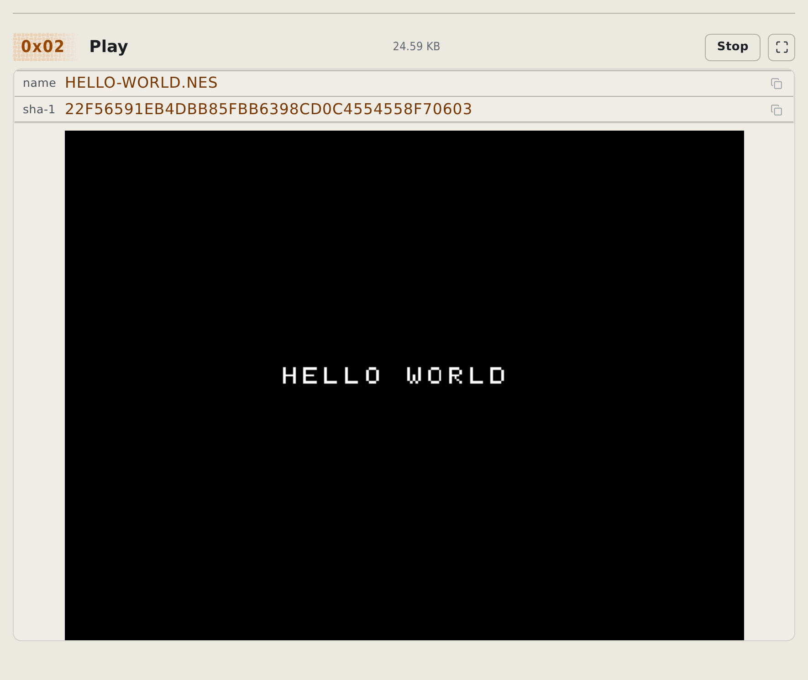
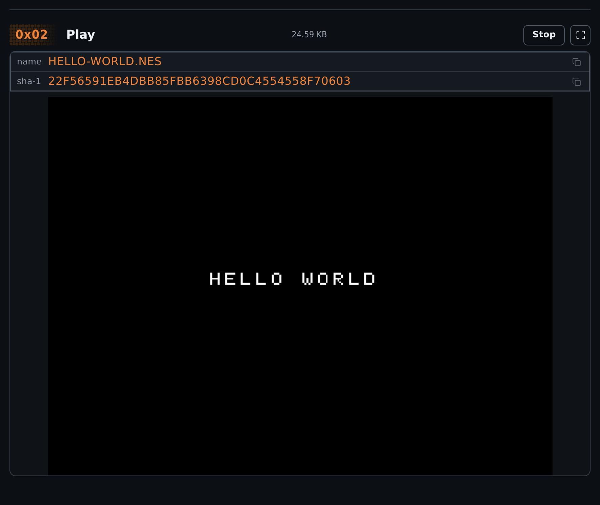

# ROM tester online: play and test a patched ROM

Use rom-weaver's ROM tester online to test a patched ROM before downloading it. Open [Test](https://rom-weaver.com/test-rom) to play local games through EmulatorJS. Play NES, SNES, Game Boy, GBA, Nintendo 64, Nintendo DS, and PlayStation games.

Your ROM stays on your device; no upload or account is required.

To verify the exact file a patch requires, use [Checksum](checksum-roms-browser.md) to compare its hash with the author's expected value, or [Identify](identify-roms-browser.md) to look up a known game, region, and revision. Playing a game successfully does not verify its checksum.

If you need a practice file, open [guided Test](https://rom-weaver.com/test-rom?guide=test). It loads a tiny homebrew NES ROM from this project.

<!-- START doctoc -->
## Table of contents

- [Check platform support](#check-platform-support)
- [Load a ROM](#load-a-rom)
- [Test an Apply result](#test-an-apply-result)
- [Switch games or stop](#switch-games-or-stop)
- [Use saves and fullscreen](#use-saves-and-fullscreen)
- [Export and restore a save](#export-and-restore-a-save)
- [Disable save storage](#disable-save-storage)
- [Fix a game that does not start](#fix-a-game-that-does-not-start)

<!-- END doctoc -->

## Check platform support

1. Check [browser emulator support](../reference/formats.md#browser-emulator-support) for your game's platform and the bundled core limitations.
2. For GameCube, Wii, Nintendo 3DS, Dreamcast, or PlayStation 2 games, use an emulator for that platform. Converting, patching, or identifying a ROM in rom-weaver does not mean the browser player supports it.
3. Keep the original ROM and use a copy when testing a patch.

## Load a ROM

1. Open [Test](https://rom-weaver.com/test-rom).
2. Drop a ROM onto **0x01 Load a game**, or select that area to choose a file.
3. If the player shows **START GAME**, select it. Touch devices can require this tap before playback starts.
4. Use the controls inside the emulator player.

You can also add a ZIP or 7z archive. rom-weaver shows the extraction progress, then opens a supported ROM from the archive.

A CHD that rom-weaver identifies as Sony PlayStation or Sega Mega Drive or Genesis opens without extraction. A CHD identified as Sega CD or Mega-CD has no bundled core and does not play. The emulator core reads the CHD directly, so a multi-track CD plays as one file. Add the `.chd` file itself, not an archive that contains it. A CHD for any other platform, including Saturn, is extracted first.

[Browser emulator support](../reference/formats.md#browser-emulator-support) lists the platforms with bundled cores.

<figure class="docs-screenshot">
  <picture data-docs-screenshot-theme="light">
    <source media="(max-width: 520px)" type="image/avif" srcset="../screenshots/test-player-mobile-light.avif" width="1170" height="2314">
    <source type="image/avif" srcset="../screenshots/test-player-desktop-light.avif" width="1770" height="1489">
    <source media="(max-width: 520px)" type="image/webp" srcset="../screenshots/test-player-mobile-light.webp" width="1170" height="2314">
    
  </picture>
  <picture data-docs-screenshot-theme="dark">
    <source media="(max-width: 520px)" type="image/avif" srcset="../screenshots/test-player-mobile-dark.avif" width="1170" height="2314">
    <source type="image/avif" srcset="../screenshots/test-player-desktop-dark.avif" width="1770" height="1489">
    <source media="(max-width: 520px)" type="image/webp" srcset="../screenshots/test-player-mobile-dark.webp" width="1170" height="2314">
    
  </picture>
  <figcaption>The supplied homebrew ROM runs in Test. The fingerprint identifies the file used for stored saves.</figcaption>
</figure>

## Test an Apply result

To test a patched ROM online, send the Apply result directly to the browser player:

1. Load your ROM and patches on the [Apply Patches page](https://rom-weaver.com/apply-patches).
2. Set **Open Test after patching** under **Options**, then apply the patches. If the option warns that the platform cannot be tested, use another emulator or the target hardware.
3. Select **Open in the Test tab** after Apply finishes.
4. Play far enough to exercise the patched content.
5. Return to Apply and download the result if you have not downloaded it.

The **Open Test after patching** option can open Test automatically or hide the Test button. Apply skips automatic testing for unsupported platforms. Its disabled Test button names the unsupported platform.

Use **Download after patching** to choose whether Apply downloads the result automatically.

An emulator test does not prove that every part of a patch works. Keep the clean original and test important paths on the target hardware when possible.

## Switch games or stop

Select **Choose another ROM** to replace the current game. Select **Stop** to unload the game and return to the Test start screen.

The emulator pauses when you leave the Test page or hide the browser tab. It resumes when you return.

## Use saves and fullscreen

Use the emulator menu to create a save state or save the game's SRAM. rom-weaver stores the save bytes in this browser.

Each save uses the ROM's SHA-1 checksum as its identity. The record also stores the file name as a display name. Thus, the same ROM finds its save after you rename the file.

The panel above EmulatorJS shows the current file name and complete SHA-1. Storage shows the same value as a ROM fingerprint. You only need these values when you troubleshoot a save mismatch.

Use the fullscreen button above the player to enter or leave fullscreen. On iPhone and iPad, the button uses a full-viewport player because Safari does not offer fullscreen for this type of content.

## Export and restore a save

Export a save before you clear browser data or move to another browser.

1. Load the ROM on the [Test page](https://rom-weaver.com/test-rom).
2. Create a save state or save the game's SRAM from the emulator menu.
3. Open **Settings**, then select **Saves & storage**.
4. Find the ROM under **Emulator saves**.
5. Select **Export** and keep the downloaded ZIP file.

Restore the save in a browser that has the same ROM:

1. Open **Settings**, then select **Saves & storage**.
2. Select **Import save**.
3. Choose the exported rom-weaver ZIP file.
4. Confirm that the ROM name and SHA-1 appear under **Emulator saves**.
5. Load the same ROM on the Test page.
6. Select **Load State** from the emulator menu.

**Saves & storage** also accepts the older uncompressed JSON export.

You can also drop an exported ZIP or JSON file on any page. **Saves & storage** opens with the file ready to import; select **Import** to restore it. If the drop also holds ROMs, those are opened first.

An import replaces the stored save for that ROM. When one exists, the import form names it and when it last changed, so you can export it first.

To import a raw SRAM or save-state file:

1. Open **Settings**, then select **Saves & storage**.
2. Select **Import save**.
3. Choose the file exported by the emulator settings.
4. Select **SRAM** or **Save state**.
5. Enter the ROM's 40-character SHA-1.

The import merges with any other save part for the same SHA-1. You can select **Delete** before the import if you want to test the complete restore process.

To load a raw SRAM file without its SHA-1:

1. Drop the `.sav`, `.srm`, `.sra`, `.eep`, `.fla`, `.mpk`, `.mcr`, or `.mcd` file on the home page or on Test. You can drop its ROM with it.
2. If you dropped the save alone, add the ROM for that game on Test, unless the game is already loaded.

The game restarts with the save. rom-weaver stores the save for that ROM if the ROM has no stored SRAM. Otherwise the save plays as a preview: Test says so, and progress in it is not stored. Import it in **Saves & storage** to replace the stored save.

Only one save loads at a time. When you drop several, Test names the ones it ignored.

A save dropped alone plays in the game that is already loaded when its system fits; otherwise it waits on Test until you add a ROM. A `.eep`, `.sra`, `.fla`, or `.mpk` file only opens a Nintendo 64 ROM, and a `.mcr` or `.mcd` file only a PlayStation ROM. A save waiting for a ROM does not replace one the Save editor sent to Test. While save storage is off, it is kept only until you reload or close the page, and Test shows a warning.

## Disable save storage

1. Open **Settings**.
2. Clear **Store emulator saves on this device**.
3. Select **Save**.

New save states and SRAM are not stored while this setting is off. Existing saves remain in **Saves & storage** until you delete them.

Use the **Delete** action in **Saves & storage** to remove one game. Use your browser's site-data controls to remove all rom-weaver data.

## Fix a game that does not start

- **No emulator core for this system:** check [browser emulator support](../reference/formats.md#browser-emulator-support).
- **A Famicom Disk System `.fds` game shows a BIOS message:** these games need the FDS BIOS, and the Test page cannot load one yet, so the emulator does not start. The same applies to an `.fds` file inside a ZIP or 7z archive and to an Apply result. [Issue #1223](https://github.com/rom-weaver/rom-weaver/issues/1223) tracks BIOS support.
- **WebGL 2 is required:** enable hardware acceleration or use a browser that supports WebGL 2.
- **An archive does not load:** extract it yourself, then add the ROM file.
- **A save does not appear:** load the same ROM bytes. rom-weaver uses the ROM's SHA-1 checksum to find its saves.
- **An imported save does not load:** confirm that its SHA-1 matches the ROM shown in Storage.
- **The player has no sound on iPhone or iPad:** start the game inside the player. Safari requires that direct tap before it enables audio.

The emulator and its selected cores download from rom-weaver's own origin. Load a game for each system you plan to use while online, so its emulator core is cached before you go offline.
